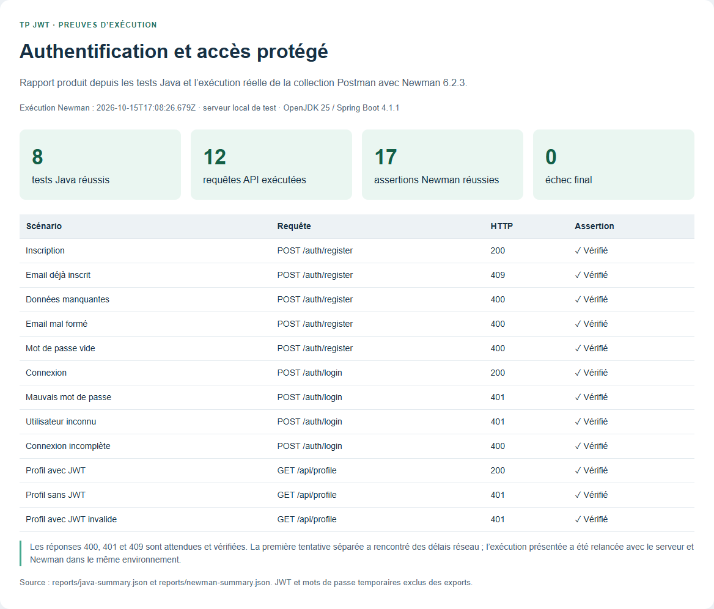
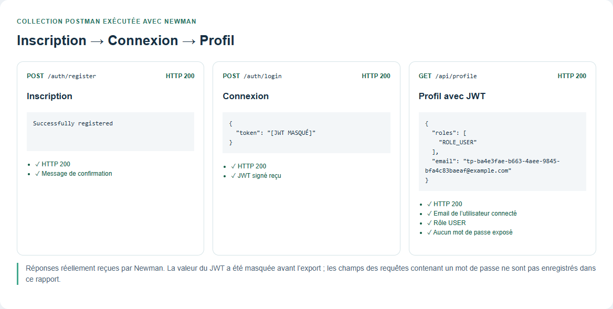
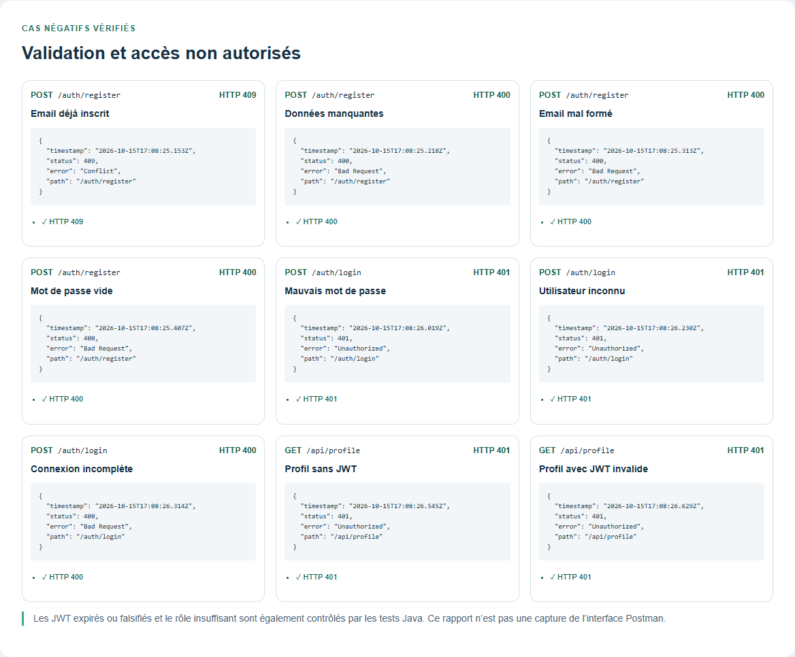

# TP JWT — Authentification avec Spring Security

API REST pédagogique permettant de créer un compte, de se connecter et d’accéder
à un profil protégé par un jeton JWT signé. Le projet reprend le TP et les
enregistrements du cours des 8 et 15 octobre 2026, avec des adaptations documentées.

## Contexte et objectifs

Comprendre le parcours complet d’authentification : stockage d’un utilisateur,
vérification du mot de passe avec BCrypt, signature du JWT, puis contrôle d’accès
à chaque requête sans session HTTP. Ce dépôt contient un backend ; aucune
interface graphique utilisateur n’est incluse.

## Fonctionnalités

- Inscription avec e-mail unique et rôle `USER` attribué côté serveur.
- Mots de passe hachés avec BCrypt, jamais renvoyés dans les réponses.
- Connexion par e-mail et mot de passe ; retour d’un JWT signé.
- Vérification de la signature, de l’expiration et de l’utilisateur du JWT.
- Profil accessible avec un JWT valide et le rôle `USER`.
- Erreurs HTTP : saisie invalide `400`, accès non authentifié `401`, rôle insuffisant
  `403`, inscription en double `409`.
- Base H2 en mémoire et console activable pour le développement local.
- Tests d’intégration Java et collection Postman v2.1 exécutable avec Newman.

## Technologies

| Technologie | Usage |
|---|---|
| Java, niveau de langage 17 | Code source ; vérifications exécutées avec OpenJDK 25 |
| Spring Boot 4.1.1 / Spring MVC | Application et routes HTTP |
| Spring Security 7.1.1 | Authentification, BCrypt et contrôle d’accès |
| Spring Data JPA / Hibernate | Persistance |
| H2 | Base en mémoire |
| JJWT 0.13.0 | Création et vérification des JWT |
| Maven Wrapper | Compilation, tests et paquet JAR |
| JUnit / Java HttpClient | Tests sur un vrai serveur local |
| Postman / Newman | Scénarios API automatisés |

Lombok n’est pas nécessaire : les constructeurs et accesseurs sont explicites
pour permettre la compilation dans IntelliJ sans traitement d’annotations.

## Architecture

```text
src/main/java/ma/enset/tpjwtspring/
├── config/SecurityConfig.java
├── controller/AuthController.java
├── controller/UserController.java
├── dto/                         # Entrées et réponse d’authentification
├── entity/AppUser.java
├── repository/UserRepository.java
├── security/JwtAuthenticationFilter.java
├── service/CustomUserDetailsService.java
├── service/JwtService.java
└── TpJwtSpringApplication.java
src/main/resources/application.properties
src/test/java/ma/enset/tpjwtspring/
postman/                         # Collection et environnement sans secrets
scripts/                         # Préparation locale et lancement
docs/                            # Analyse vidéo et publication GitHub
reports/                         # Résultats nettoyés des tests exécutés
screenshots/                     # Captures réelles du rapport de tests
```

`AuthController` transmet les identifiants à l’`AuthenticationManager`, qui utilise
le repository et BCrypt. `JwtService` signe le token. Pour le profil,
`JwtAuthenticationFilter` lit `Authorization: Bearer …`, valide le JWT et renseigne
le contexte de sécurité. `SecurityConfig` applique ensuite la règle d’accès.

L’analyse des écrans du cours et les différences sont détaillées dans
[docs/analyse-video.md](docs/analyse-video.md).

## Prérequis

- JDK 17 ou supérieur ; `java -version` doit fonctionner et `JAVA_HOME` pointer vers le JDK.
- Accès Internet au premier téléchargement des dépendances Maven.
- Git pour cloner ou publier le dépôt.
- Postman, ou Node.js avec npm pour exécuter Newman (facultatif pour lancer l’API).
- Sous Linux/macOS, OpenSSL pour le script de génération de configuration.

## Installation et configuration

Après téléchargement du ZIP, extraire le projet et ouvrir un terminal **dans le
dossier contenant `pom.xml`**. Après publication, le clonage sera possible :

```sh
git clone https://github.com/VOTRE_COMPTE/tp-jwt-spring.git
cd tp-jwt-spring
```

### Windows / PowerShell

```powershell
.\scripts\New-LocalConfig.ps1
.\mvnw.cmd verify
.\scripts\Start-Project.ps1
```

Si Windows bloque les scripts locaux, générer `.env` avec cette commande native
PowerShell et lancer Maven directement, sans modifier la politique du système :

```powershell
if (-not (Test-Path .env)) {
    $keyBytes = New-Object byte[] 48
    $rng = [System.Security.Cryptography.RandomNumberGenerator]::Create()
    try { $rng.GetBytes($keyBytes) } finally { $rng.Dispose() }
    'JWT_SECRET=' + [Convert]::ToBase64String($keyBytes) | Set-Content .env -Encoding ascii
}
.\mvnw.cmd spring-boot:run
```

### Linux / macOS

```sh
sh scripts/new-local-config.sh
sh mvnw verify
sh mvnw spring-boot:run
```

Le fichier `.env.example` décrit les options ; `.env` contient la clé privée de
développement et est exclu de Git. Ne pas publier `.env`, des jetons reçus ou un
export d’environnement contenant des identifiants personnels.

| Variable | Valeur par défaut | Description |
|---|---|---|
| `JWT_SECRET` | Aucune : obligatoire pour lancer l’API | Clé HMAC en Base64, au moins 32 octets ; le script en génère 48 |
| `JWT_EXPIRATION` | `3600000` | Durée de validité en millisecondes (une heure) |
| `SERVER_PORT` | `8080` | Port HTTP |
| `H2_CONSOLE_ENABLED` | `false` | Console H2 de développement |
| `SHOW_SQL` | `false` | Affichage des requêtes SQL |

Spring Boot importe `.env` comme un fichier de propriétés. Les tests Java génèrent
leur propre clé en mémoire et ne nécessitent pas de secret dans le dépôt.

### IntelliJ IDEA

1. **File → Open** : ouvrir le dossier contenant `pom.xml`.
2. Importer/recharger Maven et sélectionner un JDK compatible, niveau de langage 17.
3. Générer `.env` depuis le terminal du projet.
4. Ouvrir `TpJwtSpringApplication.java`, puis lancer `main` avec le triangle vert.
5. Vérifier que le répertoire de travail de cette configuration est le dossier de `pom.xml`.

L’application écoute sur `http://localhost:8080`. La racine `/` n’est pas une page
d’accueil et peut renvoyer 401 : utiliser les routes documentées ci-dessous.
Arrêter le serveur avec `Ctrl+C` dans le terminal ou le bouton Stop d’IntelliJ.

## API

Préfixe local : `http://localhost:8080`.

| Méthode | Route | Authentification | Réponse attendue |
|---|---|---|---|
| POST | `/auth/register` | Aucune | 200 et `Successfully registered` |
| POST | `/auth/login` | Aucune | 200 et un objet contenant `token` |
| GET | `/api/profile` | Bearer JWT, rôle USER | 200 avec `email` et `roles` |

Les corps JSON d’inscription et de connexion comportent `email` et `password`.
Utiliser ses propres données locales de test ; la collection génère ces valeurs
automatiquement. Le mot de passe ne doit pas dépasser 72 octets UTF-8 (BCrypt).
L’e-mail ne doit pas dépasser 255 caractères et son format est contrôlé simplement.

La connexion renvoie un objet de la forme :

```json
{ "token": "<JWT reçu à l’exécution>" }
```

Envoyer ce token dans l’en-tête `Authorization: Bearer <JWT>` pour le profil.
Il n’existe pas de routes PUT, PATCH ou DELETE dans ce périmètre.

### Console H2 locale (optionnelle)

Dans `.env`, définir `H2_CONSOLE_ENABLED=true`, puis redémarrer l’application.
Ouvrir `http://localhost:8080/h2-console` : JDBC URL
`jdbc:h2:mem:securitydbdemo`, utilisateur local `sa`, champ Password vide.
Cette base du TP est en mémoire ; les comptes disparaissent au redémarrage.
Ne pas activer cette console sur un service exposé publiquement.

## Tests Java

```powershell
.\mvnw.cmd test
```

Pour compiler, tester et créer le JAR :

```powershell
.\mvnw.cmd verify
java -jar target/tp-jwt-spring-0.0.1-SNAPSHOT.jar
```

Ces commandes sont à lancer depuis la racine, après génération de `.env` pour le
lancement du JAR. Les tests couvrent la persistance, le hachage, le parcours HTTP,
les données manquantes, l’e-mail invalide, les doublons, les mauvais identifiants,
les JWT absents/falsifiés/expirés, un utilisateur inconnu et le rôle insuffisant.

## Collection Postman et exécution Newman

Fichiers :

- [Collection v2.1](postman/TP-JWT.postman_collection.json)
- [Environnement local](postman/Local.postman_environment.json)

Dans Postman, importer les deux fichiers, sélectionner l’environnement local,
puis lancer **toute la collection dans l’ordre** avec le Collection Runner.
Le premier scénario crée des données temporaires ; la connexion mémorise le JWT
uniquement pour les requêtes suivantes. Une exécution complète peut être répétée.

Alternative en ligne de commande, avec l’API déjà démarrée :

```sh
npx --yes newman@6.2.3 run postman/TP-JWT.postman_collection.json -e postman/Local.postman_environment.json
```

Les mots de passe temporaires et JWT ne doivent pas être exportés dans un rapport
Newman brut public. Le rapport publié ici ne garde que les résultats utiles,
avec la valeur du JWT masquée.

## Vérifications exécutées et captures

Les résultats constatés sont consignés dans [docs/verification.md](docs/verification.md)
et les fichiers JSON nettoyés du dossier `reports/`. Les images ci-dessous sont des
captures du rapport HTML généré à partir de ces exécutions réelles. Ce sont des
résultats **Newman**, et non des captures de l’application Postman. Aucun résultat
issu de la vidéo du professeur n’est réutilisé comme preuve.

### Résultat global



### Parcours d’inscription, connexion et profil



### Rejets attendus



## Limites et améliorations possibles

- Base volatile : absence de persistance après redémarrage.
- Pas d’interface graphique, de validation d’e-mail par message ou de récupération de mot de passe.
- Pas de refresh token, de révocation anticipée ou de déconnexion côté serveur.
- Pas de gestion administrative des rôles, de limitation des tentatives ou de déploiement HTTPS fourni.
- Une seule clé HMAC locale ; la changer invalide les tokens précédents.
- Projet pédagogique vérifié localement ; un déploiement nécessite une configuration adaptée.

## Publication GitHub

Voir [docs/publication-github.md](docs/publication-github.md) pour créer le dépôt et
envoyer les commits. Une proposition de description figure dans
[docs/description-github.txt](docs/description-github.txt).

## Références

- [Configuration externe Spring Boot](https://docs.spring.io/spring-boot/reference/features/external-config.html)
- [Spring Security : authentification par mot de passe](https://docs.spring.io/spring-security/reference/servlet/authentication/passwords/index.html)
- [JJWT](https://github.com/jwtk/jjwt)
- [Newman, exécuteur de collections Postman](https://github.com/postmanlabs/newman)

Ce travail reprend un TP de cours ; consulter l’analyse vidéo pour distinguer
les éléments du tutoriel, les adaptations et les vérifications complémentaires.
