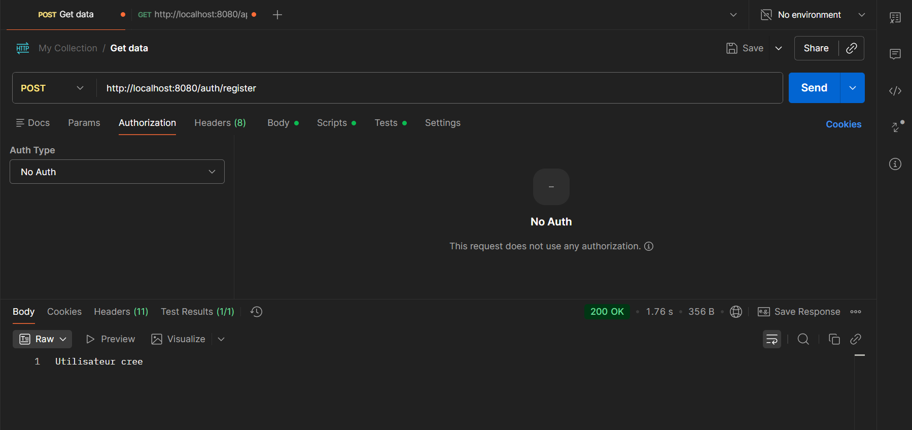
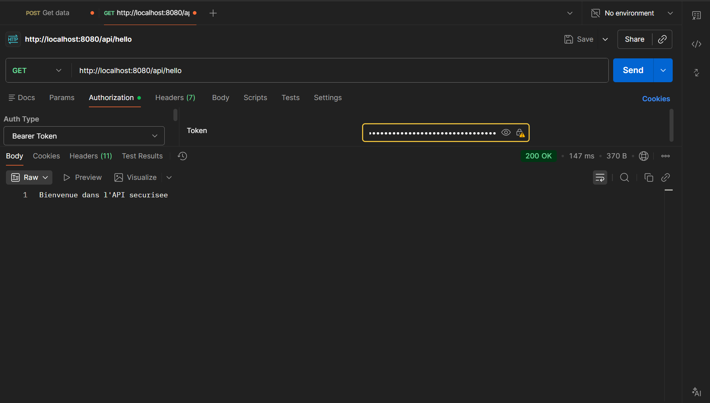
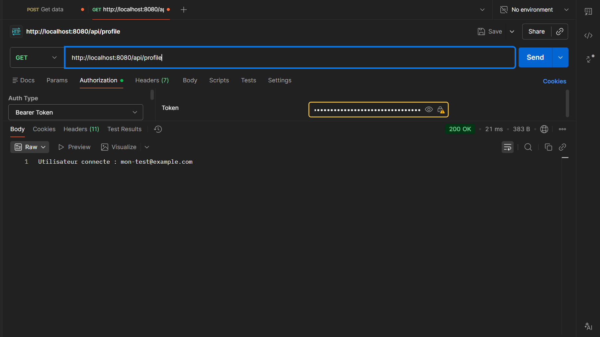
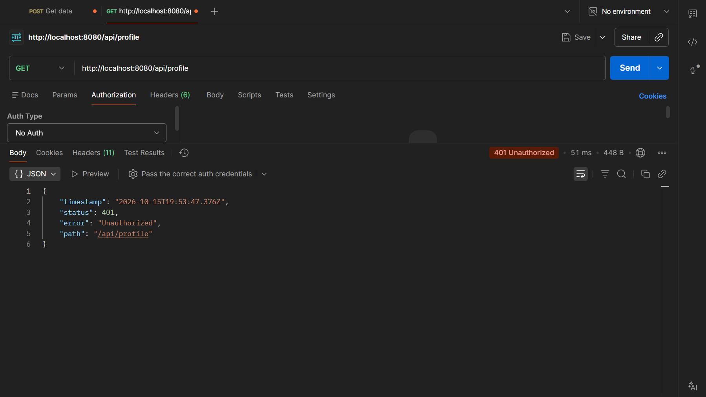
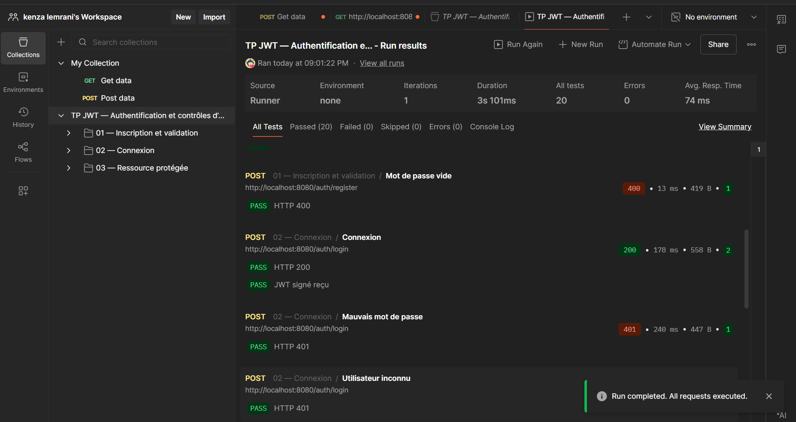

# Validation de l’API avec Postman

Ces tests ont été réalisés manuellement par l’utilisatrice dans Postman le
15 octobre 2026, puis complétés par une exécution de la collection dans le
Collection Runner. Les captures ci-dessous proviennent de ces manipulations
réelles ; elles n’ont pas été retouchées pour modifier les résultats.

## Résultats observés

| Scénario | Méthode et route | Résultat observé |
|---|---|---|
| Inscription | POST `/auth/register` | 200 OK — `Utilisateur cree` |
| Connexion | POST `/auth/login` | 200 OK — JWT reçu, également vérifié par le Runner |
| Message protégé | GET `/api/hello` avec JWT | 200 OK — message de bienvenue |
| Profil protégé | GET `/api/profile` avec JWT | 200 OK — e-mail de l’utilisateur connecté |
| Profil sans authentification | GET `/api/profile` avec No Auth | 401 Unauthorized |
| Collection complète | 14 requêtes, une itération | 20 tests réussis, 0 échec, 0 erreur |

Les comptes utilisés sont des données de test. Les valeurs de JWT et les mots
de passe ne sont pas publiés dans les captures retenues. Le champ Bearer Token
est masqué dans les images du message protégé et du profil.

## 1. Inscription

**Requête :** `POST http://localhost:8080/auth/register`, avec `No Auth`.

Le corps JSON comporte un e-mail de test et un mot de passe de test. Le serveur
attribue le rôle `USER` et stocke le mot de passe sous forme de hash BCrypt.

**Résultat attendu et obtenu :** `200 OK` avec le texte `Utilisateur cree`.
La capture atteste la réponse HTTP et le message ; le hachage est vérifié par
les tests Java, et ne peut pas être déduit de cette seule image.

## 2. Connexion et réception du JWT

**Requête :** `POST http://localhost:8080/auth/login`, avec les mêmes identifiants
que pour l’inscription et `No Auth`.

**Résultat attendu et obtenu :** `200 OK` avec un objet JSON contenant le champ
`token`. Cette valeur est ensuite utilisée pour accéder aux routes protégées.

La capture dédiée de connexion reçue pendant la séance montrait le JWT complet :
elle n’est donc pas ajoutée au dépôt. La capture du [bilan automatisé ci-dessous](#6-bilan-de-la-collection)
montre la requête **Connexion**, son code **200**, et les deux assertions réussies :
**HTTP 200** et **JWT signé reçu**, sans exposer la valeur du token.

L’assertion Postman vérifie la présence et la structure du JWT ; la vérification
cryptographique de signature est effectuée côté serveur par `JwtService` et
contrôlée par les tests Java.

## 3. Accès au message protégé

**Requête :** `GET http://localhost:8080/api/hello`.

Dans **Authorization → Bearer Token**, seule la valeur du JWT est renseignée,
sans guillemets ni corps JSON. Postman construit l’en-tête `Authorization`.

**Résultat attendu et obtenu :** `200 OK` et `Bienvenue dans l'API securisee`.
Le serveur a accepté le token et autorisé l’accès à la ressource.

## 4. Accès au profil connecté

**Requête :** `GET http://localhost:8080/api/profile`, avec le même Bearer Token.

**Résultat attendu et obtenu :** `200 OK` et
`Utilisateur connecte : mon-test@example.com`.
Le profil est renvoyé en texte, conformément au support du TP.

## 5. Refus d’accès sans token

**Requête :** `GET http://localhost:8080/api/profile`, en sélectionnant **No Auth**.

**Résultat attendu et obtenu :** `401 Unauthorized`.
Le même endpoint accepte un JWT valide et refuse une requête sans
authentification. Ce résultat est un test réussi du contrôle d’accès.

## 6. Bilan de la collection

La collection `postman/TP-JWT.postman_collection.json` a été importée dans
Postman puis exécutée avec **Run manually**, les **14 requêtes sélectionnées**,
**1 itération** et **0 ms de délai**.

Le Runner affiché dans la capture confirme :

- **20 tests exécutés et réussis** ;
- **0 échec**, **0 test ignoré**, **0 erreur** ;
- une durée affichée de **3 s 101 ms**.

Les réponses `400` et `401` des scénarios de validation, de mauvais mot de passe
ou d’accès non autorisé sont attendues. Leur assertion est considérée comme
réussie lorsque le code HTTP reçu correspond au code attendu.

## Reproduire les vérifications

1. Lancer `TpJwtSpringApplication` et attendre le démarrage sur le port 8080.
2. Garder l’application démarrée pendant tout le parcours.
3. Importer la collection et, si souhaité, l’environnement local du dossier `postman/`.
4. Exécuter la collection entière dans l’ordre : elle génère des données temporaires.
5. Pour le parcours manuel, suivre [le guide Postman](guide-postman.md).

La base H2 étant en mémoire, les comptes sont perdus après l’arrêt du serveur.
Après un redémarrage, refaire l’inscription avant la connexion. Si le token
expire, refaire la connexion et remplacer sa valeur dans la requête protégée.

## Portée de la validation

Ces captures attestent le parcours réalisé dans Postman. Elles complètent les
résultats des tests Java et Newman décrits dans [la vérification technique](verification.md).
Elles ne constituent pas une validation d’un déploiement en production.
